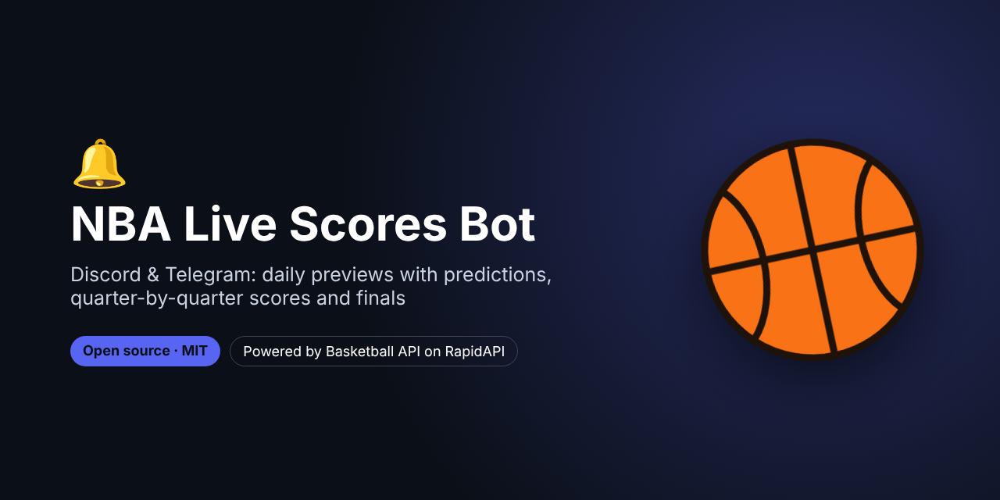
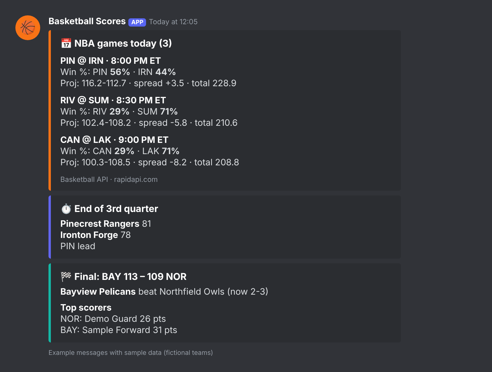
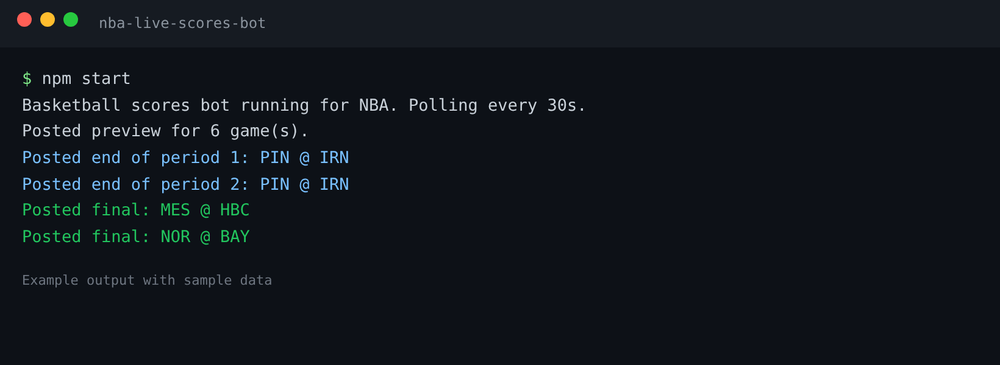

# NBA Live Scores Bot – Discord & Telegram



> **For faster support reply, contact us on Telegram: [@pintoflow](https://t.me/pintoflow)**

A **Discord and Telegram bot for NBA scores**. It posts:

- 📅 a **daily preview** of today's games with **win probabilities, projected scores, spreads and totals**
- ⏱️ **live score updates at the end of every quarter** (and overtime)
- 🏁 **final scores** with each team's **top scorer**

Follow every game or **only your teams**. It works for the **NBA, WNBA, G League and NCAA**. It's Node.js with **zero dependencies**, and you can run it **free on GitHub Actions**.

Powered by the **[Basketball API (NBA, WNBA, G League, NCAA)](https://rapidapi.com/belchiorarkad-FqvHs2EDOtP/api/api-basketball-nba)** on RapidAPI.





<sub>Example messages and output with fictional teams and sample data.</sub>

---

## Quick start

```bash
git clone https://github.com/BelNaruto/nba-live-scores-bot.git
cd nba-live-scores-bot
cp .env.example .env     # add RAPIDAPI_KEY and DISCORD_WEBHOOK_URL (or Telegram)

npm start                # live mode: preview + quarter updates + finals
npm run preview          # post today's preview once
npm run finals           # post finished games once (for cron)
npm run dry              # print messages instead of sending them
```

1. Get an API key: **https://rapidapi.com/belchiorarkad-FqvHs2EDOtP/api/api-basketball-nba**
2. **Discord:** Server Settings → Integrations → Webhooks → New Webhook → Copy URL
3. **Telegram (optional):** create a bot with [@BotFather](https://t.me/BotFather) and add the token and chat ID to `.env`

## Settings (`.env`)

| Variable | Default | Meaning |
|---|---|---|
| `RAPIDAPI_KEY` | – | Your RapidAPI key (required) |
| `DISCORD_WEBHOOK_URL` | – | Discord channel webhook |
| `TELEGRAM_BOT_TOKEN` / `TELEGRAM_CHAT_ID` | – | Telegram bot and chat |
| `LEAGUE` | `nba` | `nba`, `wnba`, `gleague`, `ncaam`, `ncaaw` |
| `TEAMS` | all | Only these teams, e.g. `LAL,BOS,GS` |
| `PREVIEW_HOUR_ET` | `12` | Hour (US Eastern) to post the daily preview |
| `POLL_SECONDS` | `30` | Live polling interval (minimum 15; live data refreshes about every 10 s) |

## Run free on GitHub Actions

The included workflow posts the **daily preview** and the **final scores** (every 30 minutes in the evening, US time):

1. Fork this repo.
2. Go to **Settings → Secrets and variables → Actions** and add `RAPIDAPI_KEY` and `DISCORD_WEBHOOK_URL` (and/or `TELEGRAM_BOT_TOKEN`, `TELEGRAM_CHAT_ID`). Optional variables: `LEAGUE`, `TEAMS`.
3. Enable workflows in the **Actions** tab.

Quarter-by-quarter live updates need the bot running continuously (`npm start`) on a server, a Raspberry Pi or a small cloud instance.

## How it works

| Endpoint | Used for |
|---|---|
| `GET /v2/predictions` | Today's games with win probabilities and projected scores (preview) |
| `GET /v2/games/live` | Games in progress, refreshed about every 10 s (quarter updates) |
| `GET /v2/games` | Today's games with final scores and game leaders (finals) |

The bot remembers what it already posted in `state.json`, so you never get the same message twice.

## Related projects

- 📊 [NBA Player Props Analyzer](https://github.com/BelNaruto/nba-player-props-analyzer): hit rates, trends and prop projections
- 🔮 [NBA Predictions Dashboard](https://github.com/BelNaruto/nba-predictions-dashboard): win probabilities, projected scores and title odds
- 📘 [Basketball API docs and examples](https://github.com/BelNaruto/basketball-api-nba)

## Support

> **For faster support reply, contact us on Telegram: [@pintoflow](https://t.me/pintoflow)**

API: https://rapidapi.com/belchiorarkad-FqvHs2EDOtP/api/api-basketball-nba

---

MIT License. Not affiliated with the NBA, Discord or Telegram.

**Keywords:** nba discord bot, nba live scores bot, nba scores telegram bot, basketball discord bot, nba game alerts, nba score notifications, wnba discord bot, college basketball bot, basketball api
